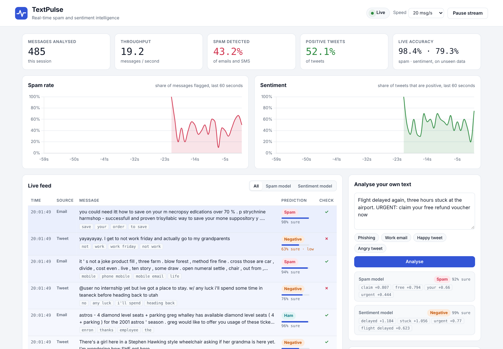

# AI & ML Projects

Machine learning and AI projects by **Shubham**, a full-stack developer (C#, ASP.NET Core, React, SQL Server, Azure) currently doing the PG Certification in AI/ML at IIIT Hyderabad. Each project is complete and runnable: real public datasets, trained and evaluated models, a working application, tests, and documentation written so a beginner can follow the code.

## Projects

### [TextPulse](textpulse): real-time spam and sentiment intelligence



Two text classifiers trained on **1.64 million real messages**, streamed live through a web dashboard that shows every prediction, the words that drove it, and running accuracy against the true labels.

| | |
| --- | --- |
| **Results** | Spam detection **97.95%** accuracy on 7,133 unseen emails and SMS · Sentiment **82.30%** on 320,000 unseen tweets |
| **Scale** | 1,635,663 records scored in 42.5 seconds |
| **Data** | Sentiment140 (1.6M tweets), SMS Spam Collection, Enron-Spam |
| **Stack** | Python, scikit-learn (TF-IDF, Naive Bayes, Logistic Regression), pandas, FastAPI, WebSockets, JavaScript, Chart.js, pytest |
| **Highlights** | Real-time WebSocket stream, explainable predictions, model comparison, safe display mode for presentations, REST API with auto-generated docs |

[Project README](textpulse/README.md) · [Code walkthrough](textpulse/docs/CODE_WALKTHROUGH.md) · [Run it in VS Code](textpulse/docs/RUN_IN_VSCODE.md)

## Coming next

More projects will be added here as the programme continues, including the IIIT Hyderabad capstone.

## Learning notes

The daily lessons and notebooks behind these projects are in [ml-30-days](https://github.com/sgoel2718/ml-30-days).

## Repository layout

Each project lives in its own folder with its own README, `requirements.txt`, tests and docs, so it can be cloned and run independently:

```
AI-ML-Projects/
├── README.md        this page
└── textpulse/       real-time spam and sentiment dashboard
```
